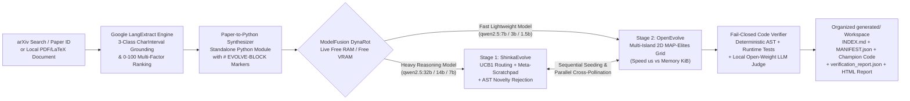

# ArXiv-to-Code (`arxiv-to-code`)

<p align="center">
  <strong>Autonomous arXiv Research Discovery • Google LangExtract 3-Class Source Grounding • Paper-to-Python Code Synthesis • ModelFusion DynaRot Hardware-Aware Model Routing • Combined ShinkaEvolve + OpenEvolve Evolutionary Search (CLI & Universal MCP Server)</strong>
</p>

<p align="center">
  
  
  
  
  
  
  
</p>

---

## 📚 Indexable Documentation Sitemap

- **[`docs/INDEX.md`](docs/INDEX.md)** — Master Documentation Sitemap, Package Module Index & Concept Glossary
- **[`docs/CLI_REFERENCE.md`](docs/CLI_REFERENCE.md)** — Complete CLI Flag Reference (`--search`, `--arxiv-id`, `--extract-doc`, `--langextract-llm`, `--dynarot`, `--install-models`, `--evolves`, `--evolve-mode`, `--evolve-count`, `--verify-llm`, `--langgraph`, `--mcp`, `--test`)
- **[`docs/MCP_SERVER_GUIDE.md`](docs/MCP_SERVER_GUIDE.md)** — Universal MCP Server Guide (All 9 JSON-RPC Tools & IDE Setup for Antigravity, Cursor, VS Code, Windsurf, Claude Desktop)
- **[`docs/DYNAROT_MODEL_ROUTING.md`](docs/DYNAROT_MODEL_ROUTING.md)** — ModelFusion DynaRot Dynamic Available Memory Law, 4-Objective Pareto Knee-Point Selection & Compute Budget Splitting
- **[`docs/SHINKA_OPENEVOLVE_ARCHITECTURE.md`](docs/SHINKA_OPENEVOLVE_ARCHITECTURE.md)** — Combining `ShinkaEvolve` + `OpenEvolve` via `EVOLVE-BLOCK`, Sequential Two-Stage Pipeline & Parallel Cross-Pollinating Ensemble

---

## 🏛️ System Architecture



### Core Capabilities

1. **arXiv Research Discovery & 0–100 Multi-Factor Ranking (`langextract_engine.py`)**:
   - Searches arXiv, enforces strict novelty gating against already-implemented papers (`CODEBASE_IMPLEMENTED_PAPERS`), detects verified GitHub/GitLab repositories (`+20 pt` bonus), and ranks papers across Grounded Vector Density (`35 pts`), Severity Tier (`30 pts`), Empirical & Mathematical Rigor (`20 pts`), and Temporal Recency (`15 pts`).
2. **3-Class Google LangExtract Character-Span Grounding**:
   - Every extraction (`breakout_vector`, `mathematical_formulation`, `defense_countermeasure`) is anchored to exact character offsets (`CharInterval(start_pos, end_pos)`) in the source text with zero hallucination, and rendered via `langextract.visualize()` into interactive HTML reports.
3. **Zero-Mock Paper-to-Python Code Synthesis (`python_code_generator.py`)**:
   - Synthesizes standalone, runnable, self-tested Python modules implementing asymmetric meet-semilattice delegation scopes ($S_1 \sqcap S_2$), constant-time HMAC-SHA256 envelope seals, pairwise session composition guards, and conformal Doob submartingale kernels inside `# EVOLVE-BLOCK-START` ... `# EVOLVE-BLOCK-END` blocks.
4. **ModelFusion DynaRot Dynamic Hardware Sizing & Auto-Provisioning (`dynarot.py`)**:
   - Sizes local models strictly by **live available free RAM** and **free GPU VRAM** (never total RAM) and splits compute between heavy reasoning models for `ShinkaEvolve` and fast lightweight mutation models for `OpenEvolve`:
     - **Free RAM $\ge 48\text{ GB}$ OR Free VRAM $\ge 24\text{ GB}$**: Primary `qwen2.5:32b` | Shinka Heavy: `qwen2.5:32b` | OpenEvolve Fast: `qwen2.5:7b`
     - **Free RAM $\ge 24\text{ GB}$ OR Free VRAM $\ge 14\text{ GB}$**: Primary `qwen2.5:14b` | Shinka Heavy: `qwen2.5:14b` | OpenEvolve Fast: `qwen2.5:3b`
     - **Free RAM $\ge 12\text{ GB}$ OR Free VRAM $\ge 4.5\text{ GB}$**: Primary `qwen2.5:7b` | Shinka Heavy: `qwen2.5:7b` | OpenEvolve Fast: `qwen2.5:1.5b`
     - **Free RAM $\ge 6\text{ GB}$ OR Free VRAM $\ge 2\text{ GB}$**: Primary `qwen2.5:3b` | Shinka Heavy: `qwen2.5:3b` | OpenEvolve Fast: `qwen2.5:1.5b`
     - **Free RAM $< 6\text{ GB}$**: Primary `qwen2.5:1.5b` | Shinka Heavy: `qwen2.5:1.5b` | OpenEvolve Fast: `qwen2.5:0.5b`
5. **Combined `--evolve` (`--evolves`) Flag Pairing `ShinkaEvolve` + `OpenEvolve` (`evolve_engine.py`)**:
   - Supports **Sequential Two-Stage Pipeline** (`--evolve-mode sequential`), **Parallel Cross-Pollinating Ensemble** (`--evolve-mode parallel`), and **Hybrid Mode** (`--evolve-mode hybrid`), with `--evolve-count <N>` controlling the number of full evolution rounds and live `tqdm` percentage progress bars + animated console spinners.
6. **Fail-Closed Deterministic + Local Open-Weight LLM Code Verification (`llm_verifier.py`)**:
   - Audits generated and evolved Python modules via `--verify-llm` (and MCP Tool 9 `verify_generated_python_code`) using Layer 1 Deterministic AST/Security/Anti-Mock/Unit-Test checks paired with Layer 2 Open-Weight LLM-as-a-Judge via local Ollama (sized by DynaRot, zero API key required) scoring Paper Fidelity, Correctness, and Security (`0–100`) and writing `verification_report.json`.

---

## 🚀 Quickstart

### Installation
```powershell
git clone https://github.com/oyesanyf/arxiv-to-code.git
cd arxiv-to-code
pip install -e .
```

### Run the 9-Step Automated Self-Test Suite, `--help`, & Pytest via `arixv_to_code.py`
```powershell
# Inspect full categorized CLI help documentation
python arixv_to_code.py --help

# Inspect MCP server JSON catalog of all 9 MCP tools
python arixv_to_code.py --list-tools

# Run the 9-step end-to-end self-test suite
python arixv_to_code.py --test

# Run the full Pytest suite directly via flag
python arixv_to_code.py --pytest
```

### Organized Default `generated/` Workspace Layout
Every run writes into `generated/` (or your custom `--output-dir`) with automatic self-indexing so you always know what is inside:
```text
generated/
├── INDEX.md                              # Master table of all papers, scores, speedups, verdicts & paths
├── MANIFEST.json                         # Machine-readable catalog of every run
└── arxiv_2603_02277_quantifying_frontier_llm/
    ├── README.md                         # Paper overview, grounded spans, verification & run commands
    ├── metadata.json                     # Full arXiv metadata, rank breakdown & extractions
    ├── extraction_results.jsonl          # Google LangExtract JSONL output
    ├── langextract_report.html           # Interactive Google LangExtract HTML visualization
    ├── verification_report.json          # Created when --verify-llm is active (Deterministic + LLM Judge)
    ├── src/
    │   └── arxiv_2603_02277_module.py    # Baseline synthesized Python module (# EVOLVE-BLOCK)
    ├── eval/
    │   └── evaluate_arxiv_2603_02277.py  # Standalone deterministic evaluator
    └── evolved/                          # Created when --evolves is active
    │   ├── champion_arxiv_2603_02277.py  # Best evolved champion across all --evolve-count rounds
    │   ├── evolution_report.json         # Full ShinkaEvolve + OpenEvolve MAP-Elites metrics & round history
    │   └── elites/                       # Individual ShinkaEvolve & OpenEvolve island elite files
    └── rl/                               # Created when --rl / --dream-rsi is active (arXiv:2609.14858)
        ├── rl_champion_arxiv_2603_02277.py # Dream-RSI RL optimized champion module
        ├── rl_report.json                # RSI cycles, promoted policy & 5-baseline 95% CI empirical benchmark
        ├── promoted_policy.json          # Serialized winning meta-exploration policy
        └── trace_pool.jsonl              # Frozen DiscoveryTree Replay Worlds (reusable across runs)
```

### Complete Flag Combination Matrix (`arixv_to_code.py`)

| Goal | Command |
|:---|:---|
| **Show all flags, DynaRot tiers, pairing modes & examples** | `python arixv_to_code.py --help` |
| **Search arXiv + Hybrid Evolution (3 rounds) + ModelFusion Panel-of-Models Verification** | `python arixv_to_code.py --search "LLM container sandbox escape" --max-results 2 --evolves --evolve-mode hybrid --evolve-count 3 --verify-panel --panel-size 3` |
| **Search arXiv + GLM Family + Local Open-Weight Ollama Google LangExtract + LLM Verify** | `python arixv_to_code.py --search "multi-agent delegation security" --model-family glm --langextract-llm --evolves --evolve-count 2 --verify-llm` |
| **Specific arXiv ID + Sequential Two-Stage (`ShinkaEvolve` $\to$ `OpenEvolve`)** | `python arixv_to_code.py --arxiv-id 2608.15888 --evolves --evolve-mode sequential --generations 4 --islands 3 --output-dir .\out_seq` |
| **Specific arXiv ID + Parallel Cross-Pollinating Ensemble** | `python arixv_to_code.py --arxiv-id 2603.02277 --evolves --evolve-mode parallel --elites-dir .\shared_elites --output-dir .\out_par` |
| **Specific arXiv ID + LLM-as-a-Judge Verification Only** | `python arixv_to_code.py --arxiv-id 2608.15888 --verify-llm` |
| **Search arXiv with score threshold & include implemented papers** | `python arixv_to_code.py --search "conformal jailbreak detection" --min-score 60 --max-results 3 --include-implemented` |
| **Extract local PDF / Markdown / Text + Interactive LangExtract HTML + Evolve** | `python arixv_to_code.py --extract-doc .\paper.pdf --html-report .\langextract_audit.html --evolves --output-dir .\out_doc` |
| **Specific arXiv ID + Interactive LangExtract HTML Report** | `python arixv_to_code.py --arxiv-id 2603.02277 --html-report .\audit_2603_02277.html --generate --output-dir .\out_html` |
| **ModelFusion DynaRot Hardware Sizing & Compute Split** | `python arixv_to_code.py --dynarot` |
| **Specific arXiv ID + Dream-RSI RL (`arXiv:2609.14858`) + 5-Baseline 95% CI Benchmark** | `python arixv_to_code.py --arxiv-id 2608.15888 --rl --rl-cycles 3 --rl-budget 12 --rl-benchmark` |
| **Dream-RSI RL with Local Ollama LLM Dreaming (`--rl-llm`) + ModelFusion Panel Verify** | `python arixv_to_code.py --arxiv-id 2608.15888 --rl --rl-llm --verify-panel --panel-size 2` |
| **Auto-Install Ollama & Dynamically Pull Resource-Fitted Models (`glm4:9b` + `deepseek-r1:7b`)** | `python arixv_to_code.py --install-models` |
| **Auto-Provision Missing Models On-Demand + Hybrid Evolve + Panel Verify** | `python arixv_to_code.py --arxiv-id 2608.15888 --auto-provision --langextract-llm --evolves --evolve-count 2 --verify-panel` |
| **Multi-Target Defense Coverage Audit** | `python arixv_to_code.py --arxiv-id 2603.02277 --audit` |
| **4-Arm HMAC-Signed LangGraph Research & Evolution Swarm** | `python arixv_to_code.py --arxiv-id 2603.02277 --langgraph --evolve-mode hybrid` |
| **Full JSON Status Report** | `python arixv_to_code.py --status` |
| **List All 9 Universal MCP Tools** | `python arixv_to_code.py --list-tools` |
| **Start Universal MCP Server (stdio JSON-RPC)** | `python arixv_to_code.py --mcp` |
| **Run Built-In 9-Step End-to-End Self-Test** | `python arixv_to_code.py --test` |
| **Run Full Pytest Suite (All Flags + LLM Verifier + MCP + DynaRot + Evolution)** | `python arixv_to_code.py --pytest` |
| **Verify + Auto-Repair Generated Code (Ruff + `mypy --strict` + Fuzzing + `pytest` + Panel)** | `python arixv_to_code.py --arxiv-id 2608.15888 --evolves --rl --verify-panel --auto-repair --max-repairs 3` |

### Run the Exhaustive Flag Test Suite & Execute Generated Champion Code
```powershell
# Run all CLI flag combination & LLM verifier tests
$env:PYTEST_DISABLE_PLUGIN_AUTOLOAD = "1"
python -m pytest -v tests/test_all_cli_flags.py tests/test_llm_code_verifier.py

# Run the generated evolved champion Python module directly (includes its own unittest & benchmark)
python .\generated\arxiv_2603_02277_quantifying_frontier_llm\evolved\champion_arxiv_2603_02277.py
```

---

## 🔌 Universal MCP Server (10 Tools)

Start the stdio JSON-RPC 2.0 MCP server:
```powershell
python arixv_to_code.py --mcp
# or
python mcp_server.py
```

Add to your IDE `mcp.json`:
```json
{
  "mcpServers": {
    "arxiv-to-code": {
      "command": "python",
      "args": ["d:\\harfile\\arixiv-to-code\\mcp_server.py"]
    }
  }
}
```

| # | MCP Tool Name | Description |
|:---:|:---|:---|
| 1 | `arxiv_to_code_status` | System health, package versions, active ModelFusion DynaRot tier, and ranking weights. |
| 2 | `dynarot_hardware_route_and_install` | Live free RAM/VRAM probe, Pareto knee-point selection, compute split, and `ollama pull` provisioning. |
| 3 | `search_and_rank_arxiv_papers` | Search arXiv, filter to novel papers, extract 3-class grounded spans, synthesize Python code, and optionally evolve. |
| 4 | `extract_document_langextract` | Extract 3-class `CharInterval` spans from an arXiv ID or local `.pdf`/`.txt`/`.md` file + interactive HTML report. |
| 5 | `generate_python_code_from_paper` | Synthesize complete, self-tested `EVOLVE-BLOCK` Python code from an arXiv paper (+ optional `evolve=True`, `use_rl=True`, `verify_llm=True`, `auto_repair=True`). |
| 6 | `evolve_python_code` | Run `evolve_count` rounds of combined `ShinkaEvolve` + `OpenEvolve` (`sequential`, `parallel`, or `hybrid`) on Python code. |
| 7 | `audit_defense_coverage` | Audit paper vectors and synthesized Python code across multi-ring containment boundaries. |
| 8 | `run_langgraph_arxiv_to_code_swarm` | Execute the 4-Arm HMAC-SHA256 signed StateGraph Research & Evolution Swarm. |
| 9 | `verify_generated_python_code` | Fail-closed Layer-1 Gate (AST + Ruff + `mypy --strict` + Property-Based Fuzzing + `pytest`) + Open-Weight LLM / ModelFusion Panel-of-Models verification + optional iterative `auto_repair=True` retry loop. |
| 10 | `optimize_code_with_dream_rsi_rl` | Dream-RSI Reinforcement Learning (`arXiv:2609.14858`): evolving Replay Worlds, zero-cost offline dreaming & 5-baseline 95% CI benchmark. |
