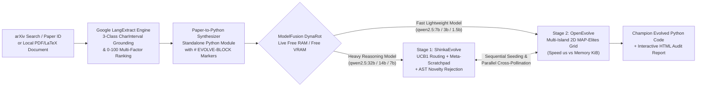

# ArXiv-to-Code (`arxiv-to-code`)

<p align="center">
  <strong>Autonomous arXiv Research Discovery • Google LangExtract 3-Class Source Grounding • Paper-to-Python Code Synthesis • ModelFusion DynaRot Hardware-Aware Model Routing • Combined ShinkaEvolve + OpenEvolve Evolutionary Search (CLI & Universal MCP Server)</strong>
</p>

<p align="center">
  
  
  
  
  
</p>

---

## 📚 Indexable Documentation Sitemap

- **[`docs/INDEX.md`](docs/INDEX.md)** — Master Documentation Sitemap, Package Module Index & Concept Glossary
- **[`docs/CLI_REFERENCE.md`](docs/CLI_REFERENCE.md)** — Complete CLI Flag Reference (`--query`, `--arxiv-id`, `--extract-doc`, `--dynarot`, `--install-models`, `--evolve` / `--evolves`, `--evolve-mode`, `--langgraph`, `--mcp`, `--test`)
- **[`docs/MCP_SERVER_GUIDE.md`](docs/MCP_SERVER_GUIDE.md)** — Universal MCP Server Guide (All 8 JSON-RPC Tools & IDE Setup for Antigravity, Cursor, VS Code, Windsurf, Claude Desktop)
- **[`docs/DYNAROT_MODEL_ROUTING.md`](docs/DYNAROT_MODEL_ROUTING.md)** — ModelFusion DynaRot Dynamic Available Memory Law, 4-Objective Pareto Knee-Point Selection & Compute Budget Splitting
- **[`docs/SHINKA_OPENEVOLVE_ARCHITECTURE.md`](docs/SHINKA_OPENEVOLVE_ARCHITECTURE.md)** — Combining `ShinkaEvolve` + `OpenEvolve` via `EVOLVE-BLOCK`, Sequential Two-Stage Pipeline & Parallel Cross-Pollinating Ensemble

---

## 🏛️ System Architecture



### Core Capabilities

1. **arXiv Research Discovery & 0–100 Multi-Factor Ranking (`langextract_engine.py`)**:
   - Searches arXiv, enforces strict novelty gating against already-implemented papers (`CODEBASE_IMPLEMENTED_PAPERS`), detects verified GitHub/GitLab repositories (`+20 pt` bonus), and ranks papers across Grounded Vector Density (`35 pts`), Severity Tier (`30 pts`), Empirical & Mathematical Rigor (`20 pts`), and Temporal Recency (`15 pts`).
2. **3-Class Google LangExtract Character-Span Grounding**:
   - Every extraction (`breakout_vector`, `mathematical_formulation`, `defense_countermeasure`) is anchored to exact character offsets (`CharInterval(start_pos, end_pos)`) in the source text with zero hallucination, and rendered via `langextract.visualize()` into interactive HTML reports.
3. **Zero-Mock Paper-to-Python Code Synthesis (`python_code_generator.py`)**:
   - Synthesizes standalone, runnable, self-tested Python modules implementing asymmetric meet-semilattice delegation scopes ($S_1 \sqcap S_2$), constant-time HMAC-SHA256 envelope seals, pairwise session composition guards, and conformal Doob submartingale kernels inside `# EVOLVE-BLOCK-START` ... `# EVOLVE-BLOCK-END` blocks.
4. **ModelFusion DynaRot Dynamic Hardware Sizing & Auto-Provisioning (`dynarot.py`)**:
   - Sizes local models strictly by **live available free RAM** and **free GPU VRAM** (never total RAM) and splits compute between heavy reasoning models for `ShinkaEvolve` and fast lightweight mutation models for `OpenEvolve`:
     - **Free RAM $\ge 48\text{ GB}$ OR Free VRAM $\ge 24\text{ GB}$**: Primary `qwen2.5:32b` | Shinka Heavy: `qwen2.5:32b` | OpenEvolve Fast: `qwen2.5:7b`
     - **Free RAM $\ge 24\text{ GB}$ OR Free VRAM $\ge 14\text{ GB}$**: Primary `qwen2.5:14b` | Shinka Heavy: `qwen2.5:14b` | OpenEvolve Fast: `qwen2.5:3b`
     - **Free RAM $\ge 12\text{ GB}$ OR Free VRAM $\ge 4.5\text{ GB}$**: Primary `qwen2.5:7b` | Shinka Heavy: `qwen2.5:7b` | OpenEvolve Fast: `qwen2.5:1.5b`
     - **Free RAM $\ge 6\text{ GB}$ OR Free VRAM $\ge 2\text{ GB}$**: Primary `qwen2.5:3b` | Shinka Heavy: `qwen2.5:3b` | OpenEvolve Fast: `qwen2.5:1.5b`
     - **Free RAM $< 6\text{ GB}$**: Primary `qwen2.5:1.5b` | Shinka Heavy: `qwen2.5:1.5b` | OpenEvolve Fast: `qwen2.5:0.5b`
5. **Combined `--evolve` (`--evolves`) Flag Pairing `ShinkaEvolve` + `OpenEvolve` (`evolve_engine.py`)**:
   - Supports **Sequential Two-Stage Pipeline** (`--evolve-mode sequential`), **Parallel Cross-Pollinating Ensemble** (`--evolve-mode parallel`), and **Hybrid Mode** (`--evolve-mode hybrid`).

---

## 🚀 Quickstart

### Installation
```powershell
git clone https://github.com/oyesanyf/arxiv-to-code.git
cd arxiv-to-code
pip install -e .
```

### Run the 8-Step Automated Self-Test Suite, `--help`, & Pytest
```powershell
# Inspect full categorized CLI help documentation
python cli.py --help

# Inspect MCP server help & JSON catalog of all 8 MCP tools
python mcp_server.py --help
python mcp_server.py --list-tools

# Run the 8-step end-to-end self-test suite
python cli.py --test

# Run the Pytest suite
pytest -v tests/
```

### CLI Usage Examples
```powershell
# 1. Inspect live RAM/VRAM hardware tier, Pareto knee-point model, and compute split
python cli.py --dynarot

# 2. Automatically install/pull optimal Ollama models based on runtime available resources
python cli.py --install-models

# 3. Search arXiv, extract 3-class LangExtract spans, and generate Python code
python cli.py --query "LLM container sandbox escape" --max-results 3 --output-dir .\generated

# 4. Synthesize Python code for arXiv:2608.15888 and evolve with ShinkaEvolve + OpenEvolve
python cli.py --arxiv-id 2608.15888 --evolves --evolve-mode hybrid --output-dir .\generated

# 5. Extract a local PDF/text document and generate an interactive LangExtract HTML report
python cli.py --extract-doc .\paper.pdf --html-report .\langextract_audit.html --evolves

# 6. Execute the 4-Arm HMAC-SHA256 Signed Research & Evolutionary Swarm
python cli.py --arxiv-id 2603.02277 --langgraph
```

---

## 🔌 Universal MCP Server (8 Tools)

Start the stdio JSON-RPC 2.0 MCP server:
```powershell
python mcp_server.py
# or
python cli.py --mcp
```

Add to your IDE `mcp.json`:
```json
{
  "mcpServers": {
    "arxiv-to-code": {
      "command": "python",
      "args": ["d:\\harfile\\arixiv-to-code\\mcp_server.py"]
    }
  }
}
```

| # | MCP Tool Name | Description |
|:---:|:---|:---|
| 1 | `arxiv_to_code_status` | System health, package versions, active ModelFusion DynaRot tier, and ranking weights. |
| 2 | `dynarot_hardware_route_and_install` | Live free RAM/VRAM probe, Pareto knee-point selection, compute split, and `ollama pull` provisioning. |
| 3 | `search_and_rank_arxiv_papers` | Search arXiv, filter to novel papers, extract 3-class grounded spans, synthesize Python code, and optionally evolve. |
| 4 | `extract_document_langextract` | Extract 3-class `CharInterval` spans from an arXiv ID or local `.pdf`/`.txt`/`.md` file + interactive HTML report. |
| 5 | `generate_python_code_from_paper` | Synthesize complete, self-tested `EVOLVE-BLOCK` Python code from an arXiv paper (+ optional `evolve=True`). |
| 6 | `evolve_python_code` | Run combined `ShinkaEvolve` + `OpenEvolve` (`sequential`, `parallel`, or `hybrid`) on Python code. |
| 7 | `audit_defense_coverage` | Audit paper vectors and synthesized Python code across multi-ring containment boundaries. |
| 8 | `run_langgraph_arxiv_to_code_swarm` | Execute the 4-Arm HMAC-SHA256 signed StateGraph Research & Evolution Swarm. |
