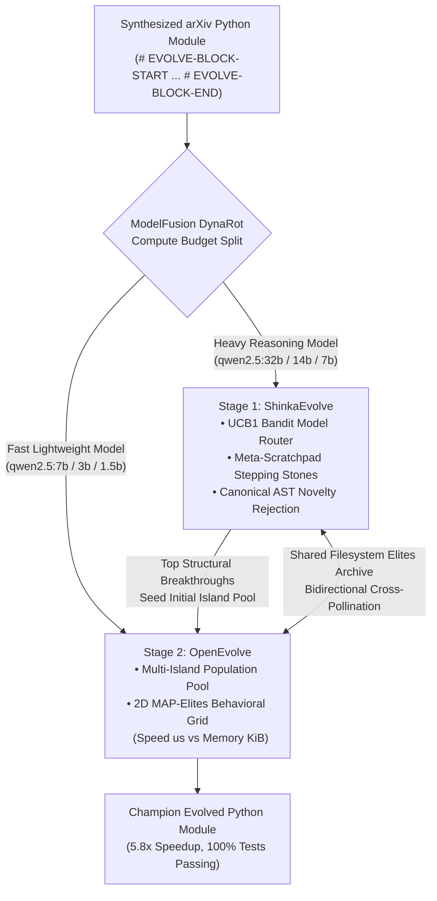

# Combining ShinkaEvolve and OpenEvolve (`--evolve` / `--evolves`)

`src/arxiv_to_code/evolve_engine.py` pairs **ShinkaEvolve** and **OpenEvolve** into a unified evolutionary search engine for optimizing Python modules synthesized from arXiv papers.

---

## 1. Shared Compatibility Contract: `EVOLVE-BLOCK` & Deterministic Scorer

Both frameworks operate on standalone Python source files containing `# EVOLVE-BLOCK-START` and `# EVOLVE-BLOCK-END` around the mutable algorithmic kernel:

```python
# EVOLVE-BLOCK-START
def scan_and_score_payload(
    payload_corpus: str,
    indicators: Sequence[str],
    prior_wealth: float = 1.0,
    alpha: float = 0.01,
) -> Tuple[Tuple[str, ...], float, float, bool]:
    ...
# EVOLVE-BLOCK-END
```

Every candidate program is evaluated in an isolated module namespace by `evaluate_python_candidate()` across 3 repeated trials using `time.perf_counter()` and `tracemalloc`:

$$F_{\text{total}} = \min\Big(100.0, \; S_{\text{correctness}} + S_{\text{speed}} + S_{\text{memory}} + S_{\text{invariant}}\Big)$$

- **$S_{\text{correctness}}$ (max $45\text{ pts}$)**: Proportion of unit and security invariant tests passed (`4/4` required for elite promotion).
- **$S_{\text{speed}}$ (max $25\text{ pts}$)**: $25.0 / \big(1 + \ln(1 + \text{median\_time\_us} / 4.0)\big)$.
- **$S_{\text{memory}}$ (max $20\text{ pts}$)**: $20.0 / \big(1 + \ln(1 + \text{median\_peak\_kib} / 2.5)\big)$.
- **$S_{\text{invariant}}$ (max $10\text{ pts}$)**: Preserves `# EVOLVE-BLOCK-START`/`# EVOLVE-BLOCK-END` markers and satisfies all formal invariants.

---

## 2. Two Complementary Pairing Architectures



### A. Sequential Two-Stage Pipeline (`--evolve-mode sequential`)
1. **Stage 1 (`ShinkaEvolve` — Primary Discovery Engine)**:
   - **UCB1 Model Routing (`ShinkaUCBRouter`)**: Dynamically routes structural mutation queries across heavy reasoning models using $Q_i + c \sqrt{\frac{2 \ln N}{n_i}}$.
   - **Meta-Scratchpad (`ShinkaMetaScratchpad`)**: Logs algorithmic breakthroughs, fitness deltas ($\Delta F$), and structural insights across generations.
   - **Novelty Rejection (`ShinkaNoveltyArchive`)**: Hashes canonical `ast.dump()` trees with SHA-256 and immediately rejects structurally redundant mutations without wasting evaluation tokens.
2. **Stage 2 (`OpenEvolve` — Multi-Island MAP-Elites Fine-Tuner)**:
   - Seeds its multi-island population pool directly with `ShinkaEvolve`'s top-performing program files.
   - Performs high-volume micro-mutations across a **4×4 2D MAP-Elites Grid** (trading off **Peak Memory Footprint in KiB** against **Execution Latency in $\mu\text{s}$**) with periodic ring migration across islands.

### B. Parallel Cross-Pollinating Ensemble (`--evolve-mode parallel` & `hybrid`)
- Runs `ShinkaEvolve` (on the heavy reasoning model tier) and `OpenEvolve` (on the fast lightweight mutation tier) concurrently across threads, sharing a common filesystem directory (`.arxiv_to_code_elites/`).
- **OpenEvolve $\to$ ShinkaEvolve**: Periodically injects the best candidate discovered by `OpenEvolve`'s MAP-Elites grid into `ShinkaEvolve`'s archive and Meta-Scratchpad as a fresh stepping stone.
- **ShinkaEvolve $\to$ OpenEvolve**: Feeds `ShinkaEvolve`'s structural leaps back into `OpenEvolve`'s island populations to prevent stagnation in local optima.
